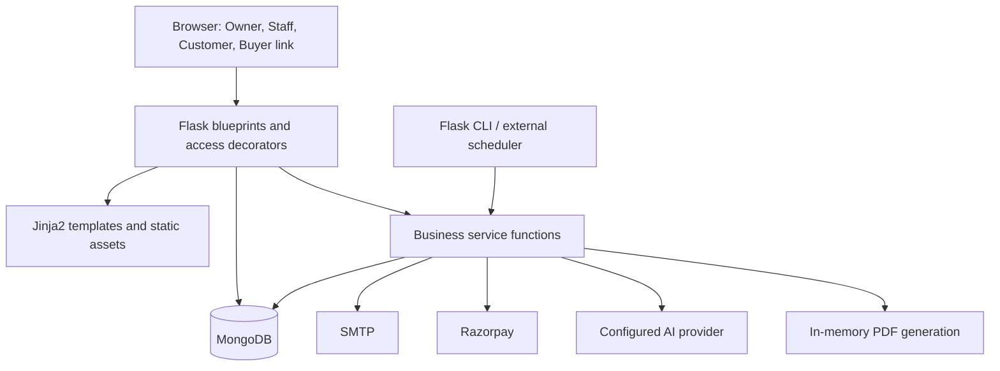
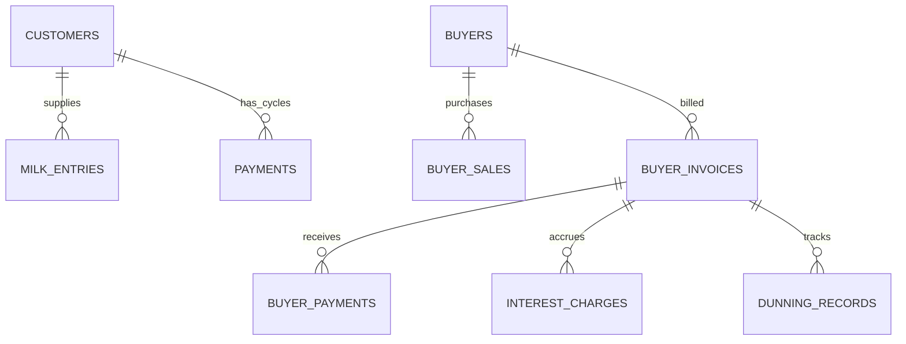
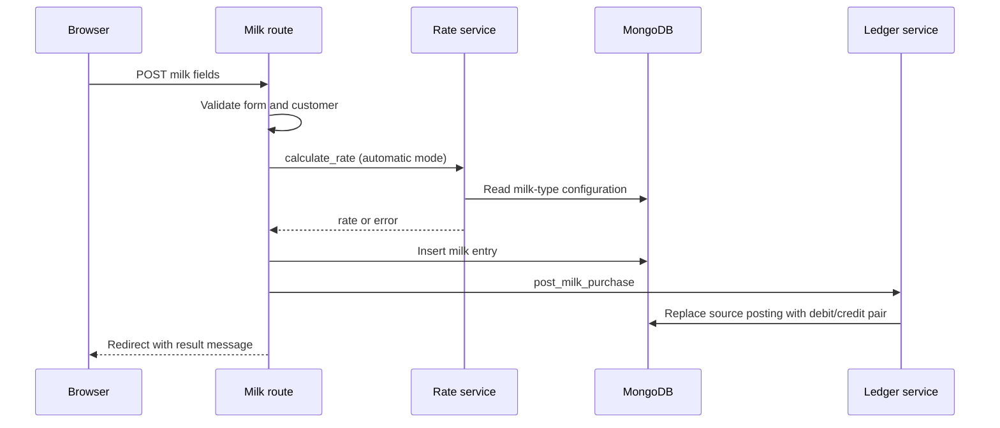
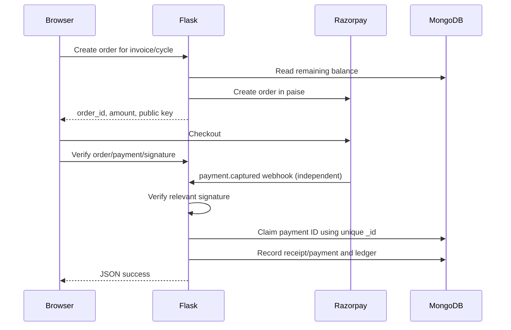

# Milk Dairy Management System — Low-Level Design

Prepared from the repository on 26 October 2026. This document describes the implementation observed in the source, not a proposed redesign. The endpoint and function inventories at the end are extracted from Python syntax without starting the application or accessing production data.

## 1. Scope and architectural style

The system is a modular monolith: one Flask WSGI application, server-rendered Jinja2 screens, browser JavaScript for interactive features, and a MongoDB database accessed through PyMongo. Optional integrations are SMTP, Razorpay, and an external AI provider. PDF generation is local through ReportLab and svglib; CSV/XLSX import uses the standard library and openpyxl.

The business has two counterparties:

- **Customer:** a farmer supplying milk; the dairy owes this party money.
- **Buyer:** a business purchasing milk; this party owes the dairy money.

There is no ORM, repository abstraction, separate frontend application, internal REST microservice mesh, message broker, or built-in job worker. Business components are Python modules with functions rather than domain classes. Routes also query MongoDB directly; services are the main home of reusable calculations and workflows, not an enforced exclusive data-access layer.



## 2. Package responsibilities and runtime initialization

| File/directory | Responsibility |
|---|---|
| `run.py` | Exposes `app = create_app()`; development server entry point. |
| `config.py` | Loads environment configuration through dotenv; validates required settings. |
| `app/__init__.py` | Factory, MongoDB client, indexes, blueprint registration, global guards, template flags, health endpoint, CLI commands. |
| `app/routes/` | HTTP parsing, route authorization, validation, database operations, orchestration, HTML/JSON/file responses. |
| `app/services/` | Pricing, cycle calculations, billing, ledger, reporting, imports, notifications, AI and gateway adapters. |
| `app/utils/` | Access decorators, atomic ID counters, CSV response helper. |
| `app/templates/` | Server-rendered UI and printable invoice views. |
| `app/static/` | JavaScript, CSS, logos, profile-image assets. |
| `tests/` | Flask test-client tests and local MongoDB/Razorpay substitutes. |

Startup:

1. Import `Config`; load `.env` values into environment-derived class attributes.
2. `create_app()` validates `SECRET_KEY` and `MONGO_URI`.
3. Create Flask, load configuration, create a `MongoClient` with a 5-second server-selection timeout, and ping MongoDB.
4. Select `MONGO_DB_NAME`; attach `app.mongo_client` and `app.db`.
5. Create the declared MongoDB indexes.
6. Configure session-cookie flags and register blueprints, template context processors, global request guard, routes, and CLI commands.
7. Gunicorn serves `run:app` in production.

The MongoClient is reused within each application process and manages its connection pool. Multiple WSGI workers have separate processes/clients. Configuration is evaluated at import time, so environment changes require process restart.

## 3. Identity, authorization, and session design

### 3.1 Session model

Flask's default session is a **signed client-side cookie**, not a server-side session store and not an encrypted container.

| Session field | Meaning |
|---|---|
| `user_id` | Logged-in administrative account. |
| `username` | Administrative display/audit identity. |
| `role` | `Owner` or `Staff`; missing role defaults to Owner in access decorators. |
| `customer_id`, `customer_name` | Customer portal identity. |
| `is_guest` | Public read-only administrative demo mode. |
| `ai_chat_history` | Last three successful question/answer pairs. |

Administrative and customer authentication use different identity keys, but login handlers clear the session; separate keys do not imply independently persistent concurrent logins in one browser session.

Passwords use Werkzeug hashing/checking. Public administrative registration does not exist. Owners manage staff accounts; initial credentials can be created using CLI commands. Portal registration finds an existing customer by a 10-digit mobile number and adds `password_hash` and `portal_registered_at` to that customer document. The shown registration implementation does not verify mobile ownership with an OTP.

### 3.2 Access primitives

| Decorator/guard | Behavior |
|---|---|
| `login_required` | Requires `user_id`; otherwise redirects to admin login. |
| `owner_required` | Requires admin login and Owner role; otherwise redirects with a message. |
| `owner_required_json` | Missing login: JSON 401; non-Owner: JSON 403. |
| `customer_login_required` | Requires `customer_id`; otherwise redirects to portal login. |
| Portal ownership checks | Match requested payment/invoice to the session customer; list queries filter by that customer. |
| `block_guest_writes` | Blocks methods other than GET/HEAD/OPTIONS for guest sessions, except the public `pay` blueprint. |
| Signed buyer payment token | Gives access to a specific invoice payment page without a buyer account. |

Owner permissions cover finances, buyers, rates, payments, accounting, notifications, staff management, and AI. Staff primarily use customers and milk entries. The dashboard separately omits financial data for staff. Account management prevents changing one's own role or deleting one's own account.

Guest mode currently reads the **same live database** as the main app. Its write guard applies at the HTTP method level; GET handlers may still perform incidental writes such as lazy initialization. Guest mode is not a separate database or a database-level read-only connection.

Cookie settings are HttpOnly, SameSite=Lax, and Secure outside debug mode. SameSite mitigates some cross-site requests but is not a complete CSRF-token mechanism.

## 4. Database design

### 4.1 Conventions

- Records are BSON documents; field conventions are maintained by Python code rather than an ORM schema.
- `_id` is normally an ObjectId; business identifiers such as `customer_id` are strings.
- Money and measurements use Python numeric values, generally floats rounded with `round(..., 2)`; Decimal128 is not used.
- Dates are generally created with UTC-aware datetimes. PyMongo reads and date-only inputs require care around naive/aware comparisons and local-day boundaries.
- Names are often copied into transaction documents for display; these are denormalized snapshots, not foreign-key constraints.
- Cross-document relationships are application-managed; MongoDB does not enforce these business references.

### 4.2 Collection field dictionary

| Collection | Main fields and logical types |
|---|---|
| `users` | `username: str`, `password_hash: str`, `role: str`, `created_at: datetime`, optional profile fields/photo. |
| `customers` | `customer_id: str`, `name`, `mobile_number`, `email`, `address`, `village`, `machine_code`, `registration_date: datetime`, `status: Active/Inactive`; optional portal hash and registration date. |
| `milk_entries` | `customer_id`, `customer_name`, `date: datetime`, `shift: Morning/Evening`, `milk_type: Cow/Buffalo`, `quantity`, `fat_percentage`, `snf_percentage`, `rate_per_litre`, `rate_mode: Manual/Automatic`, `total_amount`, `notes`, `created_at`. |
| `rate_configurations` | `milk_type`, `base_rate`, `fat_rate_per_point`, `snf_rate_per_point`; configuration metadata as set by routes. |
| `payments` | `payment_id`, `customer_id`, `customer_name`, `payment_period`, `cycle_start/end`, `total_quantity`, `total_entries`, `gross_amount`, `deductions`, `previous_pending_amount`, `final_payable_amount`, `amount_paid`, `remaining_amount`, `payment_status`, latest payment date/method/reference, timestamps; invoice number/date assigned when required. |
| `buyers` | `buyer_id`, `company_name`, `contact_person`, `mobile_number`, `email`, `address`, `gst_number`, `payment_terms_days`, `credit_limit`, `status`, `created_at`. |
| `buyer_sales` | `sale_id`, `buyer_id`, `buyer_name`, `sale_date`, `milk_type`, `quality_grade`, `quantity`, `rate_per_litre`, `gross_amount`, `tax_percentage`, `tax_amount`, `other_charges`, `total_amount`, `notes`, timestamps. |
| `buyer_invoices` | `invoice_id`, `buyer_id`, `buyer_name`, `billing_period`, `period_start/end`, `invoice_date`, `due_date`, `payment_terms_days`, quantity/count/amount totals, `principal_amount`, `interest_charged`, `interest_waived`, `total_amount`, `amount_paid`, `remaining_amount`, `status`, `overdue_days`, `last_interest_calc_date`, `last_reminder_sent_at`, timestamps. |
| `buyer_payments` | `payment_id`, `invoice_id`, `buyer_id`, `buyer_name`, `amount`, `payment_date`, `payment_method`, `transaction_reference`, `created_at`. One document per installment. |
| `expenses` | `expense_id`, `entry_type: Expense/Income`, `category`, `description`, `amount`, `date`, timestamps. |
| `ledger_entries` | `entry_id`, `transaction_id`, `date`, `transaction_type`, `entity_type/id/name`, `source_collection`, `source_id`, `description`, `account`, `side: Debit/Credit`, `amount`, `created_at`. Two documents per normal posting. |
| `interest_charges` | `charge_id`, `invoice_id`, `buyer_id/name`, `calculation_date`, `days_basis`, `balance_basis`, `annual_rate_percent`, `interest_amount`, `status`, `waived_amount`, `waived_at`, `note`, `waived_by`, `created_at`. |
| `dunning_records` | Invoice/buyer references, `record_type`, send outcome/error, `overdue_days`, `manual`, `sent_at`. |
| `notifications` | `type`, `channel`, customer reference/name, `reference_id`, `status`, `error`, `sent_at`. |
| `finance_settings` | Singleton `_id: global`, `default_payment_terms_days`, `grace_period_days`, `interest_rate_annual_percent`, `default_tax_percentage`, `updated_at`. |
| `milk_imports` | `filename`, `imported_by`, `imported_at`, `inserted`, `skipped_duplicate`, `skipped_invalid`. |
| `processed_payment_events` | `_id: Razorpay payment ID`, `processed_at`. Native `_id` uniqueness is the deduplication mechanism. |
| `counters` | `_id: sequence name`, `seq: integer`. Atomic `$inc` allocates business IDs. |

Actual collection names are `payments`, `buyer_sales`, and `notifications`; older notes using `payment_cycles`, `sales`, or `notification_log` do not match this source.

### 4.3 Relationships



An invoice selects sales by buyer and billing date range through `sales_for_invoice`; the relationship is not an enforced SQL-style foreign key. Ledger entries reference originating collections and source IDs. Notification references are also application-level.

### 4.4 Indexes actually declared at startup

| Collection | Unique indexes | Other indexes |
|---|---|---|
| `users` | `username` | — |
| `customers` | `customer_id`; `mobile_number` | `status` |
| `milk_entries` | `(customer_id, date, shift)` | `date`; `customer_id` |
| `rate_configurations` | `milk_type` | — |
| `payments` | `payment_id`; `(customer_id, payment_period)` | `payment_period`; `payment_status` |
| `buyers` | `buyer_id`; sparse `gst_number` | `status` |
| `buyer_sales` | `sale_id` | `(buyer_id, sale_date)`; `sale_date` |
| `buyer_invoices` | `invoice_id`; `(buyer_id, billing_period)` | `status`; `due_date`; `billing_period` |
| `buyer_payments` | `payment_id` | `invoice_id`; `buyer_id` |
| `expenses` | `expense_id` | `date`; `category`; `entry_type` |
| `interest_charges` | `charge_id` | `invoice_id`; `status` |
| `dunning_records` | — | `(invoice_id, sent_at descending)`; `record_type` |
| `notifications` | — | `sent_at descending`; `customer_id` |
| `ledger_entries` | `entry_id` | `(source_collection, source_id)`; `account`; `(entity_type, entity_id)`; `date`; `transaction_id` |

All collections also have MongoDB's native unique `_id` index. `machine_code` is checked in customer routes but is **not declared unique by `_create_indexes()`**. Sparse GST uniqueness does not ignore an explicitly stored null; missing and null are different cases.

## 5. Module contracts and algorithms

### 5.1 Authentication, accounts, and profile

- `auth.py`: admin login/logout and guest entry; verifies the stored password hash and sets session identity/role.
- `users.py`: Owner-only list/add/reset/change-role/delete; checks self-targeting restrictions.
- `customer_portal.py`: registration and login against customer records, then customer-scoped data access.
- `profile.py`: administrative profile update and profile image handling. Images are filesystem assets, not a separate object-storage integration.
- `decorators.py`: shared page/JSON access rules.

### 5.2 Customer lifecycle

`_read_and_validate_form(form)` normalizes customer input. Add/edit check mobile-number and optional machine-code collisions. `get_next_sequence(db, 'customer_id')` generates `CUST0001`-style IDs. Activate/deactivate changes `status`, preserving historical records. List and CSV routes support query filters; the export is a file response, not a stored report.

### 5.3 Milk collection and pricing

`_read_and_validate_form(form)` returns `(errors, data)`. Validates customer/date, no future collection date, Morning/Evening shift, Cow/Buffalo milk, positive quantity, Fat/SNF in 0–100, and a nonnegative manual rate.

`calculate_rate(db, milk_type, fat_percentage, snf_percentage) -> (rate, error)`:

```text
rate = round(max(base_rate
                 + fat_percentage * fat_rate_per_point
                 + snf_percentage * snf_rate_per_point, 0), 2)
total_amount = round(quantity * rate_per_litre, 2)
```

Automatic mode ignores the submitted browser rate and recalculates on the server. Missing rate configuration returns an error. Manual mode uses the validated entered rate.

Create inserts a milk document then calls `post_milk_purchase`. Edit updates the document and replaces the corresponding ledger posting. Duplicate checks in the route improve the user message; the unique `(customer_id, date, shift)` index is the definitive duplicate constraint. Normal manual entry creation does not automatically send email; separate notification actions perform that work.



### 5.4 Machine import

1. `parse_import_file(file_storage) -> (rows, error)` accepts CSV or XLSX and normalizes supported headers.
2. `build_preview(db, rows, default_date, default_shift, default_milk_type)` maps machine codes to customers and labels each row ready, duplicate, unknown-code, or invalid.
3. Preview returns HTML plus serialized ready rows; no milk entries are inserted yet.
4. Browser submits `rows_json`, selected `include_row` values, and filename.
5. `commit_import(db, ready_rows, filename, imported_by)` parses the selected rows again, checks customer/duplicate/selected numeric-enum inputs, and recalculates the price.
6. Each accepted row creates a milk record and ledger posting. `milk_imports` records counts and actor.

This is a file-upload integration, not a direct device connection. The commit performs useful revalidation but does not repeat every preview/manual-form constraint; it must not be described as a fully atomic or identical validation path.

### 5.5 Farmer payment cycles

`get_cycle_boundaries(year, month, cycle_number)`:

- C1: days 1–10.
- C2: days 11–20.
- C3: day 21 through month-end; not always ten days.

`make_payment_period` produces `YYYY-MM-Cn`. `generate_payments_for_cycle` aggregates milk by customer and includes customers with a positive immediately preceding cycle balance even if they supplied no milk in the new cycle.

```text
gross_amount = sum(milk_entries.total_amount in cycle)
previous_pending_amount = previous cycle's remaining_amount
final_payable_amount = round(gross_amount - deductions + previous_pending_amount, 2)
remaining_amount = max(round(final_payable_amount - amount_paid, 2), 0)
```

Regeneration preserves deductions and paid amounts. One customer-period document is updated or inserted; new IDs use `PAY00001` format.

`update_deductions(db, payment_id, deductions) -> (ok, error)` recalculates payable/status and posts a deduction adjustment to the ledger.

`record_payment(db, payment_id, amount, method, reference, payment_date) -> (ok, error)` adds to cumulative `amount_paid`, recalculates balance/status, stores the latest payment metadata, and posts the installment to the ledger. It does not store a separate farmer-installment document for every payment.

Status priority: remaining <= 0 → Paid; otherwise amount paid > 0 → Partially Paid; otherwise Pending. Carry-forward is a billing display mechanism; ledger payable balances arise from actual purchases, deductions, and payouts, so reports should not sum every overlapping cycle balance as if each were a separate liability.

### 5.6 Buyer lifecycle and sales

Buyer routes maintain profiles and status. Finance settings supply default terms/tax; buyer-specific terms may override defaults. IDs use `BYR0001`; sale IDs use `BSL00001`.

`_compute_amounts(quantity, rate, tax_percentage, other_charges)` computes rounded gross, tax, and total:

```text
gross_amount = quantity * rate_per_litre
tax_amount = gross_amount * tax_percentage / 100
total_amount = gross_amount + tax_amount + other_charges
```

Create/edit/delete synchronize the sale's ledger posting. Customer purchase records and buyer sales remain different collections and workflows; this is not an inventory-lot allocation engine.

### 5.7 Buyer billing and receipts

`get_period_boundaries(year, month, period_number)` uses days 1–15 and 16–month-end. `make_billing_period` produces `YYYY-MM-Bn`.

`generate_invoices_for_period(db, year, month, period_number, settings=None)` aggregates each buyer's sales for the period, preserving collected money and charged/waived interest on regeneration.

```text
principal_amount = sum(buyer_sales.total_amount)
net_interest = interest_charged - interest_waived
total_amount = principal_amount + net_interest
remaining_amount = max(total_amount - amount_paid, 0)
due_date = invoice_date + payment_terms_days
```

Invoice identifiers use `BINV00001`. A buyer invoice stands alone; its balance is not rolled into the next buyer invoice.

`record_buyer_payment(db, invoice_id, amount, method, reference, payment_date) -> (ok, payment_id_or_error)` inserts a `BPAY00001` installment document, posts the receipt, and increments the invoice paid total. Although one docstring describes recomputing from all receipts, the current body adds to the invoice's previously stored total.

`compute_invoice_status` is the shared status function:

1. No remaining balance: Paid.
2. Today is after due date and balance remains: Overdue, even after partial payment.
3. Some payment received before overdue: Partially Paid.
4. Otherwise: Unpaid.

### 5.8 Dunning and interest

`run_dunning_cycle(db, dairy_info)` loads finance settings, scans unpaid invoices, updates overdue status/days, attempts a first automatic reminder when no matching reminder record exists, and applies interest for newly elapsed eligible days. Manual reminders are separate actions. A failed/skipped reminder record can affect subsequent automatic-reminder eligibility because the existence lookup is by invoice/type rather than success alone.

Defaults: 15-day terms, 7-day grace period, annual rate 18%, tax default 0%.

```text
grace_end = due_date + grace_period_days
basis_date = last_interest_calc_date, otherwise grace_end
days_elapsed = today - basis_date
new_interest = round(remaining_amount * annual_rate_percent / 100 / 365
                     * days_elapsed, 2)
```

Interest begins only after grace_end. Each charge stores its calculation basis, posts a receivable/income pair, and increases invoice totals. Since `remaining_amount` can include earlier interest, repeated charges can include prior interest in their basis; the implementation is not strictly principal-only simple interest. `waive_interest_charge` records waiver metadata, adjusts invoice amounts, and posts an income reversal.

There is no background scheduler inside Flask. `flask process-dunning` or the manual web action invokes the workflow; deployment scheduling must invoke the CLI externally.

### 5.9 Expenses and other income

Expense routes validate the date, entry type, allowed category, description, and amount; IDs use `EXP00001`. Create/update/delete maintains the corresponding ledger source posting. Income records share the `expenses` collection with `entry_type=Income`.

### 5.10 General ledger

`post_transaction(db, *, source_collection, source_id, transaction_type, date, debit_account, credit_account, amount, entity_type=None, entity_id=None, entity_name=None, description='') -> transaction_id_or_None`:

1. Delete previous entries for the source key.
2. If rounded amount is zero/nonpositive, stop after voiding.
3. Allocate transaction and entry identifiers.
4. Insert equal-value Debit/Credit documents with the same transaction ID.

| Business event | Debit | Credit |
|---|---|---|
| Farmer supplies milk | Milk Purchase Expense | Accounts Payable |
| Dairy pays farmer | Accounts Payable | Cash/Bank |
| Farmer deduction | Accounts Payable | Milk Purchase Expense |
| Buyer sale | Accounts Receivable | Milk Sales Revenue |
| Buyer receipt | Cash/Bank | Accounts Receivable |
| Interest charged | Accounts Receivable | Interest Income |
| Interest waived | Interest Income | Accounts Receivable |
| Business expense | Other Expense | Cash/Bank |
| Other income | Cash/Bank | Other Income |

The actual deduction helper reduces purchase expense. Some older comments refer to Other Income and should not be treated as the current posting behavior. Sales are posted using the sale total; there is no separate GST-payable account in this chart.

Natural balances: assets/expenses use Debit minus Credit; liability/revenue accounts use Credit minus Debit. Entity ledgers filter by customer/buyer. Editable records reuse a source key; recurring installment/waiver events receive distinct source suffixes.

Replacement is sequential delete/insert, not a MongoDB multi-document transaction. Source-key indexing is nonunique; replacement is therefore not a concurrency-safe exactly-once guarantee.

### 5.11 Accounting and reporting

`accounting_service` reads ledger-based totals and operational summaries. `resolve_range` translates a selected date range into boundaries. `build_dashboard` returns a dictionary containing income/cost/profit, cash movement, expense categories, and outstanding snapshots.

```text
revenue = sales_revenue + other_income
gross_profit = revenue - milk_purchase_cost
net_profit = gross_profit - other_expenses + interest_income
net_cash_flow = cash_received - cash_paid_customers - cash_paid_expenses
```

Accrued revenue and received cash differ. Outstanding balances are current snapshots, independent of the selected historical report range. Dedicated functions provide monthly trends, entity receivables/payables, revenue/expense reports, cash-bank transactions, and profit/loss.

### 5.12 Invoices, PDFs, exports, and notifications

`invoice_service.get_or_create_invoice_number` assigns customer invoice identity when needed. `generate_invoice_pdf(dairy_info, payment, entries)` and `generate_buyer_invoice_pdf(dairy_info, invoice, buyer, sales)` return generated PDF content for HTTP download or email attachment. Jinja2 provides printable HTML views. Logo assets are loaded locally with a text fallback.

`csv_response(filename, header_row, data_rows)` produces CSV downloads. Customer, milk-entry, and buyer-invoice exports use list filters.

`email_service.send_email(...)` is the SMTP adapter, raising `EmailSendError` on delivery failure. `notification_service` loads the customer and builds milk/invoice messages, returning a small status dictionary. Actual attempted sends are logged in `notifications`; missing email/configuration returns early without a log in this path. Buyer reminders use `dunning_records`. The application has no durable outbound-message queue or automatic SMTP retry worker.

### 5.13 Online payment integration

`payment_gateway_service` encapsulates gateway configuration, order creation, signature checks, webhook verification, and event claiming. Order amounts are converted from rupees to gateway paise.

Buyer payment links use `URLSafeTimedSerializer`, the application secret, a dedicated salt, and a 30-day maximum age. Buyers do not have separate login accounts.



Webhook verification uses HMAC-SHA256 over the exact raw request body and constant-time comparison. Only `payment.captured` changes balances; other events are acknowledged and ignored. Buyer invoice and portal cycle flows share `processed_payment_events` to deduplicate browser/webhook deliveries.

Important implementation boundaries:

- Claiming an event occurs before the remaining business writes; a later failure can leave an event claimed without crediting it.
- Settlement currently uses the record's current remaining amount; it does not reconcile that amount with the captured gateway amount in these handlers.
- The shown flow does not persist a local order-to-invoice binding and reconcile it during settlement.
- The portal also offers gateway checkout against a farmer payment cycle, although that cycle represents money the dairy owes the farmer. This is an existing business-direction mismatch, not a payout integration.

### 5.14 AI integration

Provider selection is centralized in `ai_service`: Anthropic, OpenAI, Gemini, or Groq. OpenAI and Groq share the OpenAI-compatible adapter. Keys/models come from configuration; no custom model training or vector database is implemented.

| Public function | Contract |
|---|---|
| `ask_business_question(db, question, history=None)` | `(answer, error)` through a bounded tool-calling loop. |
| `draft_dunning_paragraph(buyer, invoice, overdue_days, prior_reminder_count)` | Draft text or `None`, allowing static-template fallback. |
| `generate_pnl_narrative(data, range_label, dairy_name)` | `(narrative, error)` from supplied financial totals. |
| `extract_receipt_data(image_bytes, media_type)` | `(field_dict, error)` for expense-form prefill, without saving. |

Read-only tools: business overview; today/week/month revenue and expenses; top suppliers; one customer's supply/payment details; overdue buyers; pending customer payments. Supported tool limits include up to 25 rows and a 1–90-day supply window. Chat allows at most 500 question characters, four tool-use loop iterations, and three retained question/answer pairs. New chat clears the session history.

Receipt extraction returns amount/date/description/category/entry_type/confidence. JPEG/PNG/WebP/GIF are accepted by the AI service. Groq receipt scanning is explicitly disabled. The expense route applies its own upload checks as well. Relevant questions, summaries, selected business data, and receipt images leave the server for the selected provider. AI is optional and does not own accounting calculations or database writes.

## 6. HTTP contracts

Most screens submit HTML forms and use flash messages plus redirects (Post/Redirect/Get). Exceptions are JSON actions, rate preview, file exports, and PDF responses. A complete method/path/handler/access inventory follows in Appendix A.

Representative JSON contracts:

```json
POST /ai/ask
{"question": "Which buyers are overdue?"}

Success:
{"answer": "..."}

Service failure (currently HTTP 200):
{"error": "..."}
```

```json
POST /pay/invoice/<token>/verify
{
  "razorpay_order_id": "order_example",
  "razorpay_payment_id": "pay_example",
  "razorpay_signature": "signature"
}

Success:
{"success": true}
```

Create-order responses contain `order_id`, integer `amount`, public `key_id`, counterparty display name, and dairy name. Invalid/missing/settled records produce handler-specific errors. Receipt extraction is multipart file upload, not a JSON image body.

## 7. Error handling and consistency

| Condition | Current design |
|---|---|
| Missing required config / startup database failure | Raises startup error. |
| Invalid HTML form | Collects errors, flashes messages, renders form or redirects. |
| Duplicate milk entry | Precheck plus unique index; manual creation catches `DuplicateKeyError`. |
| Missing JSON login / role | Owner JSON decorator returns 401/403. |
| Invalid payment signature | JSON error, normally 400. |
| Unconfigured webhook | JSON 503. |
| Duplicate payment event | Returns success/already-processed without another credit. |
| AI provider error | Error tuple/text; reminders fall back to static wording. |
| SMTP send error | Logged attempted delivery failure and returned status. |
| Invalid buyer link | 404 HTML/JSON depending on handler. |

Single-document ID increments and unique-index inserts are atomic. Most multi-record operations are not: source insert plus ledger posting; installment plus invoice totals; interest charge plus invoice totals; event claim plus settlement. Many totals use read-modify-write updates, so concurrent writes can lose increments. Rerunning billing generation avoids duplicate logical periods under ordinary sequential use but is not a transaction across all customers/buyers.

Design improvements would include captured-amount/order reconciliation, atomic payment state transitions, a resumable event-processing state, transactional ledger updates, precise monetary types, stronger mobile registration verification, explicit CSRF protection, and durable outbound jobs. These are future changes, not claims about the current implementation.

## 8. Operations and verification

- Production command: `gunicorn run:app`; local entry: `python run.py`.
- Required settings: `SECRET_KEY`, `MONGO_URI`; database name and branding have defaults.
- Optional settings: SMTP credentials, active AI provider key/model, Razorpay keys/webhook secret, admin summary recipient.
- Request body limit: 8 MiB.
- `/health` pings MongoDB and returns JSON; its current handler reports connectivity in the body rather than switching to an HTTP failure status.
- CLI: `create-admin`, `create-staff`, `reset-password`, `process-dunning`, `send-pl-summary`, `backfill-ledger`.
- `backfill-ledger` reconstructs source postings for historical records. It is operational migration logic, not a continuous reconciliation worker.
- Local profile images require persistence planning when hosted on an ephemeral filesystem. MongoDB backup/restore is external to the application.

Existing pytest modules cover staff management, RBAC, imports, CSV export, guest mode, and payment webhooks. Fixtures use a fake MongoDB implementation and fake Razorpay SDK, avoiding real services. These tests do not establish real MongoDB concurrency/transaction guarantees or real provider compatibility. This documentation task did not run live integration calls or change application behavior.

## Appendix A. Complete declared endpoint inventory

Generated from route decorators. `page login` means `login_required`; `owner page` means `owner_required`; `owner JSON` means `owner_required_json`; `customer login` means `customer_login_required`. No decorator means consult handler token/signature checks or public behavior, not necessarily unrestricted data access. Flask adds HEAD/OPTIONS where applicable; those implicit methods are omitted.

| Method | URL | Handler | Access |
|---|---|---|---|
| GET | `/about/` | `about.py:index` | page login |
| GET | `/accounting/` | `accounting.py:dashboard` | owner page |
| POST | `/accounting/ai-summary` | `accounting.py:ai_summary` | owner page |
| GET, POST | `/accounting/settings` | `accounting.py:settings` | owner page |
| GET | `/accounting/receivables` | `accounting.py:receivables` | owner page |
| GET | `/accounting/receivables/<buyer_id>` | `accounting.py:receivable_detail` | owner page |
| GET | `/accounting/payables` | `accounting.py:payables` | owner page |
| GET | `/accounting/payables/<customer_id>` | `accounting.py:payable_detail` | owner page |
| GET | `/accounting/revenue` | `accounting.py:revenue` | owner page |
| GET | `/accounting/expense-report` | `accounting.py:expense_report` | owner page |
| GET | `/accounting/cash-bank` | `accounting.py:cash_bank` | owner page |
| GET | `/accounting/pnl` | `accounting.py:pnl` | owner page |
| POST | `/ai/ask` | `ai_assistant.py:ask` | owner JSON |
| POST | `/ai/reset` | `ai_assistant.py:reset` | owner JSON |
| GET, POST | `/login` | `auth.py:login` | handler checks/public |
| GET | `/logout` | `auth.py:logout` | handler checks/public |
| GET | `/guest-login` | `auth.py:guest_login` | handler checks/public |
| GET | `/buyer-invoices/` | `buyer_invoices.py:list_invoices` | owner page |
| GET | `/buyer-invoices/export.csv` | `buyer_invoices.py:export_csv` | owner page |
| POST | `/buyer-invoices/generate` | `buyer_invoices.py:generate` | owner page |
| GET | `/buyer-invoices/<invoice_id>` | `buyer_invoices.py:detail` | owner page |
| POST | `/buyer-invoices/<invoice_id>/pay` | `buyer_invoices.py:pay` | owner page |
| GET | `/buyer-invoices/<invoice_id>/invoice` | `buyer_invoices.py:invoice_view` | owner page |
| GET | `/buyer-invoices/<invoice_id>/invoice/pdf` | `buyer_invoices.py:invoice_pdf` | owner page |
| POST | `/buyer-invoices/<invoice_id>/notify` | `buyer_invoices.py:notify` | owner page |
| POST | `/buyer-invoices/<invoice_id>/send-reminder` | `buyer_invoices.py:send_reminder` | owner page |
| POST | `/buyer-invoices/run-dunning` | `buyer_invoices.py:run_dunning` | owner page |
| POST | `/buyer-invoices/interest/<charge_id>/waive` | `buyer_invoices.py:waive_interest` | owner page |
| GET | `/buyer-invoices/dunning-log` | `buyer_invoices.py:dunning_log` | owner page |
| GET | `/buyer-sales/` | `buyer_sales.py:list_sales` | owner page |
| GET, POST | `/buyer-sales/add` | `buyer_sales.py:add_sale` | owner page |
| GET, POST | `/buyer-sales/edit/<sale_id>` | `buyer_sales.py:edit_sale` | owner page |
| POST | `/buyer-sales/delete/<sale_id>` | `buyer_sales.py:delete_sale` | owner page |
| GET | `/buyers/` | `buyers.py:list_buyers` | owner page |
| GET, POST | `/buyers/add` | `buyers.py:add_buyer` | owner page |
| GET, POST | `/buyers/edit/<buyer_id>` | `buyers.py:edit_buyer` | owner page |
| GET | `/buyers/<buyer_id>` | `buyers.py:profile` | owner page |
| POST | `/buyers/deactivate/<buyer_id>` | `buyers.py:deactivate` | owner page |
| POST | `/buyers/activate/<buyer_id>` | `buyers.py:activate` | owner page |
| GET, POST | `/portal/register` | `customer_portal.py:register` | handler checks/public |
| GET, POST | `/portal/login` | `customer_portal.py:login` | handler checks/public |
| GET | `/portal/logout` | `customer_portal.py:logout` | handler checks/public |
| GET | `/portal/` | `customer_portal.py:dashboard` | customer login |
| GET | `/portal/milk-entries` | `customer_portal.py:milk_entries` | customer login |
| GET | `/portal/payments` | `customer_portal.py:payments` | customer login |
| POST | `/portal/payments/<payment_id>/pay/create-order` | `customer_portal.py:create_payment_order` | customer login |
| POST | `/portal/payments/<payment_id>/pay/verify` | `customer_portal.py:verify_payment_order` | customer login |
| GET | `/portal/payments/<payment_id>/invoice` | `customer_portal.py:invoice` | customer login |
| GET | `/portal/payments/<payment_id>/invoice/pdf` | `customer_portal.py:invoice_pdf` | customer login |
| GET | `/customers/` | `customers.py:list_customers` | page login |
| GET | `/customers/export.csv` | `customers.py:export_csv` | page login |
| GET, POST | `/customers/add` | `customers.py:add_customer` | page login |
| GET, POST | `/customers/edit/<customer_id>` | `customers.py:edit_customer` | page login |
| GET | `/customers/<customer_id>` | `customers.py:profile` | page login |
| POST | `/customers/deactivate/<customer_id>` | `customers.py:deactivate` | page login |
| POST | `/customers/activate/<customer_id>` | `customers.py:activate` | page login |
| GET | `/dashboard` | `dashboard.py:index` | page login |
| GET | `/expenses/` | `expenses.py:list_expenses` | owner page |
| POST | `/expenses/ai-extract` | `expenses.py:ai_extract` | owner page |
| GET, POST | `/expenses/add` | `expenses.py:add_expense` | owner page |
| GET, POST | `/expenses/edit/<expense_id>` | `expenses.py:edit_expense` | owner page |
| POST | `/expenses/delete/<expense_id>` | `expenses.py:delete_expense` | owner page |
| GET | `/milk-entries/` | `milk_entries.py:list_entries` | page login |
| GET | `/milk-entries/export.csv` | `milk_entries.py:export_csv` | page login |
| GET, POST | `/milk-entries/add` | `milk_entries.py:add_entry` | page login |
| GET, POST | `/milk-entries/edit/<entry_id>` | `milk_entries.py:edit_entry` | page login |
| POST | `/milk-entries/<entry_id>/notify` | `milk_entries.py:notify_entry` | page login |
| POST | `/milk-entries/notify-bulk` | `milk_entries.py:notify_bulk` | page login |
| GET | `/milk-entries/import` | `milk_entries.py:import_page` | page login |
| GET | `/milk-entries/import/template` | `milk_entries.py:import_template` | page login |
| POST | `/milk-entries/import/preview` | `milk_entries.py:import_preview` | page login |
| POST | `/milk-entries/import/commit` | `milk_entries.py:import_commit` | page login |
| GET | `/notifications/` | `notifications.py:list_notifications` | owner page |
| GET | `/pay/invoice/<token>` | `pay.py:invoice_pay_page` | handler checks/public |
| POST | `/pay/invoice/<token>/create-order` | `pay.py:create_invoice_order` | handler checks/public |
| POST | `/pay/invoice/<token>/verify` | `pay.py:verify_invoice_order` | handler checks/public |
| POST | `/pay/webhook` | `pay.py:webhook` | handler checks/public |
| GET | `/payments/` | `payments.py:list_payments` | owner page |
| POST | `/payments/generate` | `payments.py:generate` | owner page |
| GET | `/payments/<payment_id>` | `payments.py:detail` | owner page |
| POST | `/payments/<payment_id>/deductions` | `payments.py:set_deductions` | owner page |
| POST | `/payments/<payment_id>/pay` | `payments.py:pay` | owner page |
| GET | `/payments/<payment_id>/invoice` | `payments.py:invoice` | owner page |
| GET | `/payments/<payment_id>/invoice/pdf` | `payments.py:invoice_pdf` | owner page |
| POST | `/payments/<payment_id>/notify` | `payments.py:notify` | owner page |
| POST | `/payments/notify-cycle` | `payments.py:notify_cycle` | owner page |
| GET, POST | `/profile/` | `profile.py:index` | page login |
| GET | `/rate-config/` | `rate_config.py:list_configs` | owner page |
| GET, POST | `/rate-config/edit/<milk_type>` | `rate_config.py:edit_config` | owner page |
| GET | `/rate-config/calculate` | `rate_config.py:calculate_preview` | owner page |
| GET | `/users/` | `users.py:list_users` | owner page |
| GET, POST | `/users/add` | `users.py:add_user` | owner page |
| GET, POST | `/users/<username>/reset-password` | `users.py:reset_password` | owner page |
| POST | `/users/<username>/role` | `users.py:change_role` | owner page |
| POST | `/users/<username>/delete` | `users.py:delete_user` | owner page |
| GET | `/` | `app/__init__.py:index` | session-based redirect |
| GET | `/health` | `app/__init__.py:health_check` | public |

## Appendix B. Service and utility function inventory

Generated signatures show implementation functions, including adapter/private helpers. Functions are module-level APIs rather than class methods.

### app/services/accounting_service.py

```python
_day_bounds(d)
resolve_range(range_type, custom_from=None, custom_to=None)
revenue_breakdown(db, start, end)
milk_purchase_cost(db, start, end)
business_expenses_total(db, start, end)
expenses_by_category(db, start, end)
interest_income_net(db, start, end)
_cash_side_by_type(db, side, transaction_type, start, end)
cash_received(db, start, end)
cash_paid_to_customers(db, start, end)
cash_paid_expenses(db, start, end)
outstanding_receivables(db)
outstanding_payables(db)
cash_bank_balance(db)
overdue_summary(db)
pending_customer_payments_summary(db)
build_dashboard(db, range_type='today', custom_from=None, custom_to=None)
monthly_trend(db, months=6)
revenue_report(db, start=None, end=None)
expense_report(db, start=None, end=None)
cash_bank_summary(db, start=None, end=None)
_as_aware_utc(dt)
cash_bank_transactions(db, start=None, end=None, limit=300)
profit_and_loss(db, start, end)
```

### app/services/ai_service.py

```python
_active_provider()
ai_configured()
_model()
_not_configured_message()
_get_client()
_clamp_int(value, default, lo, hi)
_tool_business_overview(db, tool_input)
_tool_revenue_and_expense(db, tool_input)
_tool_top_customers_by_supply(db, tool_input)
_tool_customer_details(db, tool_input)
_tool_overdue_buyers(db, tool_input)
_tool_pending_customer_payments(db, tool_input)
_run_tool(db, name, tool_input)
_ask_anthropic(client, db, question, history)
_openai_tool_specs()
_ask_openai_compatible(client, db, question, history)
_json_schema_to_gemini_schema(genai_module, schema)
_gemini_tools(genai_module)
_ask_gemini(genai_module, db, question, history)
ask_business_question(db, question, history=None)
_simple_text_completion(provider, client, prompt, max_tokens)
draft_dunning_paragraph(buyer, invoice, overdue_days, prior_reminder_count)
generate_pnl_narrative(data, range_label, dairy_name)
_receipt_schema()
_extract_receipt_anthropic(client, image_bytes, media_type, schema, today_str)
_extract_receipt_openai(client, image_bytes, media_type, schema, today_str)
_extract_receipt_gemini(genai_module, image_bytes, media_type, schema, today_str)
extract_receipt_data(image_bytes, media_type)
```

### app/services/buyer_invoice_service.py

```python
get_period_boundaries(year, month, period_number)
make_billing_period(year, month, period_number)
current_period_defaults()
compute_invoice_status(remaining_amount, amount_paid, due_date, today)
generate_invoices_for_period(db, year, month, period_number, settings=None)
record_buyer_payment(db, invoice_id, amount, method, reference, payment_date)
payments_for_invoice(db, invoice_id)
sales_for_invoice(db, invoice)
```

### app/services/dunning_service.py

```python
_log_dunning(db, invoice, record_type, status, error, overdue_days, manual)
send_dunning_reminder(db, invoice, dairy_info, overdue_days, manual=False)
notify_buyer_invoice(db, invoice, dairy_info, manual=True)
dunning_history(db, invoice_id)
calculate_and_apply_interest(db, invoice, settings, today)
waive_interest_charge(db, charge_id, waive_amount, note, actor=None)
interest_history(db, invoice_id)
run_dunning_cycle(db, dairy_info)
```

### app/services/email_service.py

```python
email_configured()
send_email(to_email, subject, html_body, attachment=None, attachment_filename=None)
send_milk_entry_email(customer, entry)
send_invoice_email(customer, payment, entries, dairy_info)
send_buyer_invoice_email(db, buyer, invoice, dairy_info)
send_dunning_reminder_email(buyer, invoice, dairy_info, overdue_days, custom_message=None)
```

### app/services/finance_settings_service.py

```python
get_settings(db)
update_settings(db, **fields)
```

### app/services/invoice_service.py

```python
get_or_create_invoice_number(db, payment)
_find_logo_path()
_load_logo_flowable(target_height=13 * mm)
_status_colors(status)
_status_badge(status, styles)
generate_invoice_pdf(dairy_info, payment, entries)
_buyer_status_colors(status)
_buyer_status_badge(status, styles)
generate_buyer_invoice_pdf(dairy_info, invoice, buyer, sales)
```

### app/services/ledger_service.py

```python
void_transaction(db, source_collection, source_id)
post_transaction(db, *, source_collection, source_id, transaction_type, date, debit_account, credit_account, amount, entity_type=None, entity_id=None, entity_name=None, description='')
date_match(start, end)
account_totals(db, account, start=None, end=None, entity_type=None, entity_id=None)
account_balance(db, account, start=None, end=None, entity_type=None, entity_id=None)
get_entity_ledger(db, entity_type, entity_id)
receivables_list(db)
payables_list(db)
post_buyer_sale(db, sale)
void_buyer_sale(db, sale_id)
post_buyer_payment(db, payment)
post_interest_charge(db, charge)
post_interest_waiver(db, charge, waive_amount, note)
post_milk_purchase(db, entry, entry_id)
post_customer_payment(db, payment, amount, payment_date, method, reference)
post_customer_deduction(db, payment, deductions)
post_expense_entry(db, entry)
void_expense_entry(db, expense_id)
```

### app/services/milk_import_service.py

```python
_normalize_header(raw)
_canonical_field_map(headers)
generate_template_csv()
parse_import_file(file_storage)
_parse_date_value(value)
build_preview(db, raw_rows, default_date_str, default_shift, default_milk_type)
commit_import(db, ready_rows, filename, imported_by)
recent_imports(db, limit=20)
```

### app/services/notification_service.py

```python
_log(db, **fields)
_send_email(db, notif_type, customer, reference_id, build_fn)
notify_milk_entry(db, entry)
notify_invoice(db, payment, dairy_info)
```

### app/services/payment_gateway_service.py

```python
gateway_configured()
_client()
create_order(amount_rupees, receipt, notes=None)
verify_payment_signature(order_id, payment_id, signature)
webhook_configured()
verify_webhook_signature(raw_body, signature)
claim_payment_event(db, razorpay_payment_id)
```

### app/services/payment_service.py

```python
get_cycle_boundaries(year, month, cycle_number)
make_payment_period(year, month, cycle_number)
get_previous_period(year, month, cycle_number)
_status_for(remaining_amount, amount_paid)
generate_payments_for_cycle(db, year, month, cycle_number)
update_deductions(db, payment_id, deductions)
record_payment(db, payment_id, amount, method, reference, payment_date)
```

### app/services/rate_service.py

```python
get_rate_config(db, milk_type)
calculate_rate(db, milk_type, fat_percentage, snf_percentage)
```

### app/utils/csv_export.py

```python
csv_response(filename, header_row, data_rows)
```

### app/utils/decorators.py

```python
login_required(view_func)
owner_required(view_func)
owner_required_json(view_func)
customer_login_required(view_func)
```

### app/utils/id_generator.py

```python
get_next_sequence(db, sequence_name)
```
